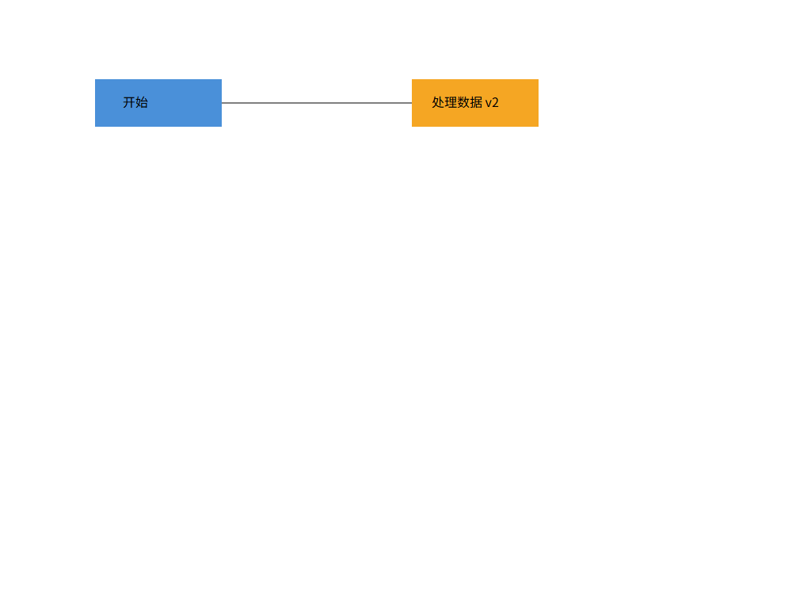

# svg-editor

高级软件开发 Lab1 Phase 1：TypeScript 面向对象 SVG 命令行编辑器。采用 Command 实现撤销重做，采用 Composite 统一图形和分组操作。

## 运行

需要 Node.js 22 或以上版本及 npm。

```sh
npm ci
npm test
npm run cli
```

在 `svg>` 下输入：

```text
init 800 600
create g node
create rect frame 120 100 160 60 #4a90d9 in node
create text label 155 135 "开始" in node
move node 0 100
undo
tree
save demo.svg
```

用浏览器打开保存的 SVG。初始化后输入 `help` 查看全部命令。输入结束或 Ctrl+C 退出，不自动保存。

## 课程案例回放

PowerShell：

```powershell
npm run build
Push-Location examples
Get-Content -Raw -Encoding utf8 .\flowchart.txt | node ..\dist\src\bootstrap\Main.js
Get-Content -Raw -Encoding utf8 .\session.txt | node ..\dist\src\bootstrap\Main.js
Pop-Location
```

其他支持输入重定向的 shell：

```sh
npm run build
cd examples
node ../dist/src/bootstrap/Main.js < flowchart.txt
node ../dist/src/bootstrap/Main.js < session.txt
```

`session.txt` 故意包含两条失败命令：非法分组和保存后撤销，并包含一次补 ID 警告。这些属于课程预期结果，执行会继续。脚本模式不输出交互提示符或颜色。

生成的 [流程图 SVG](examples/flowchart.svg)：



## 功能与约定

- 文档：`init`、`read`、`save`、`canvas`。
- 图形：rect、circle、ellipse、line、text、g；所有 create 都支持 `in`。
- 编辑：`delete`、`move`、`scale`、`set`、`group`、`ungroup`、`addto`、`front`、`back`。
- 查询：`tree [id]`、`show <id>`、`help`。
- 历史：`undo`、`redo`；成功文档操作开启新的历史段，查询和失败命令不改变历史。
- SVG：支持上述六类及嵌套、课程示例的 translate/正均匀 scale，保留导入的额外属性；不支持的元素/变换明确报错。`set` 始终严格遵守课程白名单。
- `save` 无参数使用 read 来源路径；init 创建的新文档须显式提供保存路径。
- 未初始化时按课程通用规则报无文档错误；先执行 init 或 read 再使用 help。
- ID 必须唯一、非空且不含空格、制表符或换行；区分大小写，可以使用中文，例如 `节点-1`。
- 带空格的文字、盘符路径和网络路径使用双引号，例如 `read "D:\我的 图形\demo.svg"` 或 `read "\\server\shared folder\demo.svg"`。反斜杠原样保留，只有 `\"` 表示文字中的英文双引号。

完整的架构、课程对照、设计解释、开发过程、质量证据与人工验收清单见 [doc/README.md](doc/README.md)。

## 版本管理

按课程功能阶段创建分支，在分支中保留实现与测试的小提交，并以合并提交汇入 `main`。远程仓库地址确定后推送分支和提交历史；最终验收通过后在最终提交创建 `final` 标签。
