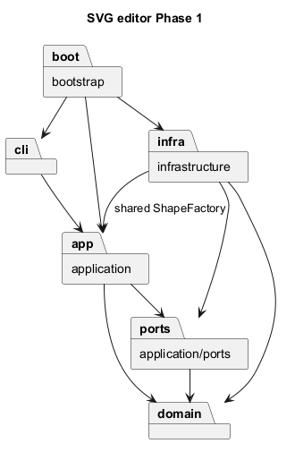
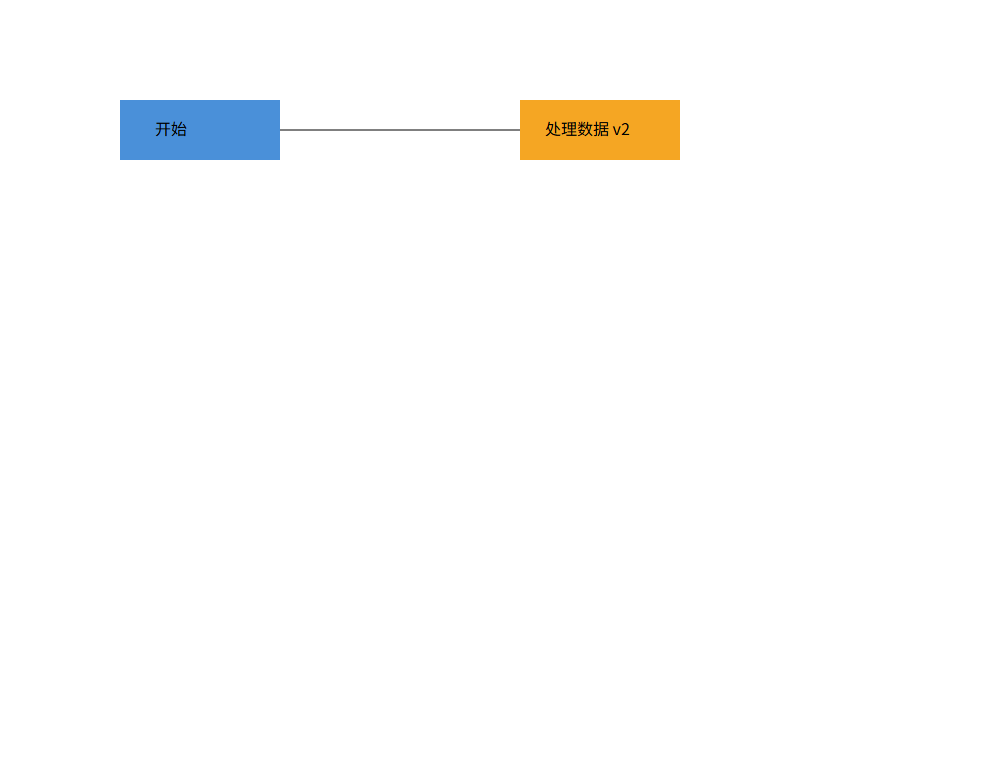

# Lab1 Phase 1：SVG 命令行编辑器

## 架构方案

本项目以课程 `phase_cli_1.md` 为依据，使用 TypeScript 实现 rect、circle、ellipse、line、text、g 六类图形，支持全部阶段一命令及 SVG 读写。

### 模块划分与依赖方向

| 目录 | 职责 | 允许依赖 |
| --- | --- | --- |
| `src/domain` | 图形几何、属性、组合树、ID 索引、文档快照 | domain |
| `src/application` | 编辑命令、历史管理、文档用例、工厂、查询与 IO 端口 | application、domain |
| `src/infrastructure` | 文件系统、SVG XML 读写适配器 | infrastructure、application、domain、Node、XML 库 |
| `src/cli` | 分词、命令分发、结构树与属性显示、REPL | cli、application、Node 输入输出 |
| `src/bootstrap` | 实例创建与依赖组装 | 上述模块 |

图源：[architecture.puml](architecture.puml)；矢量图：[architecture.svg](architecture.svg)。

domain 不依赖终端、文件或 XML；application 仅经 `ports/FileStore`、`SvgDecoder`、`SvgEncoder` 访问 IO；cli 通过应用接口操作文档；基础设施实现端口；bootstrap 集中组装具体对象。这些限制使图形与编辑行为能够脱离终端和文件系统测试。

### 设计模式及实现

- **Command**：`application/commands` 中每条编辑命令独立成类；EditCommand 保存前后快照，HistoryManager 管理执行、撤销、重做与 IO 阻断。失败时恢复快照，且不移动历史栈。
- **Composite**：Group 与叶子类共同继承 Shape。move、scale、set 等行为经多态执行；组的几何操作递归子树，删除组同时删除全部后代。
- **快照取舍**：完整快照避免浮点逆运算误差，并精确恢复父级、顺序与属性。代价是内存随图形规模和历史长度增长，当前不设置历史容量上限。
- **方案比较**：单体 REPL 会混合解析、领域行为和 IO；完整插件框架超出阶段一。采用轻量分层，保留 IO 端口与图形抽象。
- **两处待重构分派**：仅 CommandDispatcher 按命令名选择处理器，ShapeFactory 按类型名选择类。创建与导入共享工厂，显示与序列化使用多态记录；后续阶段再改为外部注册，不实现 box 插件。
- 可变字段封装，一类一文件，文件名与类名一致。ShapeRecord 等边界数据不替代具有行为的图形对象。

### 变化点假设

| 可能变化 | 预留与取舍 |
| --- | --- |
| 新图形与 box | 工厂集中创建、图形多态；插件系统留到后续阶段 |
| CLI 以外的入口 | 复用 application 用例，不依赖 readline |
| 文件或 XML 库 | 端口隔离实现，领域对象不依赖 XML |
| 历史空间 | 可改局部记录，当前优先保证恢复准确 |
| 可编辑属性 | 各图形封装白名单，导入额外属性不代表开放 set |

### 行为约定与 SVG 范围

1. init 默认 800×600；仅给宽度时高度取 600。canvas 查询不改变状态，仅给宽度时保留当前高度，修改尺寸更新 viewBox，不缩放图形。
2. 成功 init/read/save/canvas 修改尺寸清空历史并阻断 undo/redo；下一条成功编辑解除阻断，建立新历史段。查询和失败命令不改变文档、路径、历史与阻断状态。
3. create/group 必须显式提供 ID，区分大小写，全局唯一；导入缺失 ID 按类型加序号补全并打印警告。
4. group 在最近共同祖先下、最早选中位置建组，按原文档顺序收编；禁止同时选中祖先和后代。ungroup 将孩子提升到原组位置，禁止顶层解组；addto 追加末尾并防环。
5. move 为增量；scale 同乘全部几何属性，递归处理组，不改写 stroke-width、font-size 等外观属性。数值必须有限，缩放与画布尺寸为正，尺寸和半径非负。
6. save 无参数使用 read 来源；init 后首次保存须给路径；显式另存不改写 read 来源。文件先写临时文件再替换，成功后才改变历史。
7. 整行首个非空字符为 # 视为注释，带空格参数用双引号；报错后继续下一行，错误统一为 `error:` 单行输出。
8. 支持六类、嵌套、文字、公共属性及 translate/正均匀 scale，保留导入额外属性。其他元素、rotate/skew/非均匀缩放和 DTD 明确报错，不承诺完整 SVG/CSS 支持。
9. 结构编辑保留本地属性与顺序，新父级的变换和样式继承按 SVG 语义生效；不自动补偿跨父级坐标系。

## 过程记录

- 课程回放含预期错误，纠正遇错即退出的处理方式，改为逐行报错并继续。
- 创建与 SVG 导入共享工厂，避免在导入、写出、显示各自增加图形类型分派。
- 自动补 ID 改为两遍扫描：先保留全部显式 ID，再分配缺失 ID，避免提前占用后面的 rect1。
- 分组与浮点撤销采用精确快照，恢复所有原父级和兄弟顺序，不使用逆运算或简单移回根级。
- SVG 变换封装为领域对象并保留，避免导入时摊平字体、样式和嵌套坐标；组移动换算子图形增量。
- 仅关闭 readline 仍可能执行已排队输入，增加中断标记与 SIGINT 回归检查，停止后续命令并移除监听器。
- 当前 TypeScript 版本不提供原计划使用的 Compiler API，改为针对本项目编码形式的静态源码规则检查，配合人工审阅。
- 构建前清除 dist，确保测试只执行当前编译产物。
- 通过课程原始会话与流程图脚本的真实 CLI 子进程验证行为，并补全所有叶子类型的属性白名单与缩放契约。

## 一致性自查

1. **模块划分**：实际 src 目录与方案一致；test、examples、doc 分别保存测试、课程样例、报告与图。类文件同名，领域行为保留在对象内。
2. **依赖方向**：Architecture.test.ts 扫描 imports，检查 domain/application 外部依赖和 CLI 直接访问 domain 等违规情况。抽查 Main 组装、EditorSession 端口注入与 SvgReader 工厂复用。
3. **名字分派**：人工检查仅 CommandDispatcher、ShapeFactory 承担名字到处理器或类的映射；静态规则禁止 switch；reader/writer/tree/show 未增加类型注册表。
4. **封装**：图形字段、组成员、索引和历史栈封装；边界记录与快照独立，不暴露内部可变数据。
5. **方案修订**：保留变换代替导入摊平；补充 SIGINT 队列停止、干净构建与静态架构检查，原因见过程记录。模块方向未改变。

静态扫描仅检查本项目的编码形式，不构成完整 TypeScript 语义证明，仍需结合源码审阅。

## 质量保证手段

### 验证范围

| 课程要求 | 主要验证 |
| --- | --- |
| OO、同名类文件、分层、两处分派 | `test/integration/Architecture.test.ts` 与源码审阅 |
| 六类、唯一 ID、默认属性、全部 create in | `test/domain/Shapes.test.ts`、`Document.test.ts`、`test/application/Factory.test.ts`、`test/cli/Session.test.ts` |
| 几何、属性白名单、组合与顺序 | `Shapes.test.ts`、`test/application/Editing.test.ts`、`Grouping.test.ts` |
| 单命令撤销、redo 清空、精确恢复 | `test/application/History.test.ts`、`Editing.test.ts`、`Grouping.test.ts` |
| 文档命令与 IO 历史边界 | `test/application/Files.test.ts`、`History.test.ts`、`test/integration/Failures.test.ts` |
| 提示符、引号、注释、单行错误、成功摘要 | `test/cli/Parsing.test.ts`、`Repl.test.ts`、`Session.test.ts`、`Failures.test.ts` |
| tree/show/help、全部命令 | `Session.test.ts`、`test/integration/Course.test.ts` |
| SVG 读写、补 ID、转义、变换、往返 | `test/infrastructure/Reader.test.ts`、`Writer.test.ts`、`RoundTrip.test.ts`、`FileStore.test.ts` |
| 课程完整会话和两节点流程图 | `Course.test.ts` 回放两份课程脚本；核对 5 元素保存、7 元素读入与 8 元素流程图 |
| box 属后续阶段 | `Factory.test.ts`、`Session.test.ts` 验证 unknown shape type |
| Git 分步、远程与 final | 功能小提交保留；远程推送及最终标签在最终提交时核验 |

### 集成结果

Windows 环境下完成构建与 37 项测试，无失败；测试覆盖真实 CLI 子进程、文件读写和失败状态比较。测试通过表示自动覆盖的场景成立，最终仍需人工检查课程会话及浏览器显示。

课程流程图：[flowchart.svg](../examples/flowchart.svg)。

### 最终提交核验

- 从远程获取后按根目录 README 安装、构建和测试。
- 核对课程完整会话、流程图、错误文案和撤销重做。
- 查看功能分支和小提交，确认远程推送完整。
- 人工验收通过后，在截止时间前于最终提交创建并推送 `final`。
